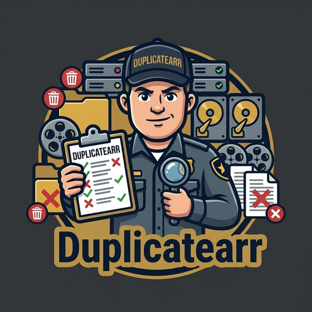

<p align="center"></p>

# Duplicatearr

Finds the same film, episode, poster or extra stored more than once in your library, even when the copies are different encodes, and helps you keep the best one.

A scan only reads. Nothing is removed until you tick a copy and press the button, and removed copies go to a recycle
folder you can restore them from.

## What it finds

Press **Scan now** on the Dashboard (scans also run by themselves once a day).

### Films and episodes stored twice

- **Films** are grouped by the TMDB or IMDb ID in the folder name (Radarr's `{tmdb-123}`, Jellyfin's `[tmdbid-123]`) or
  in the folder's `.nfo` file, and otherwise by title and year. So `Dune (2021)` and `Dune Part One (2021)` are found
  as one film when either names the ID, including across libraries such as Movies and 4K.
- **Episodes** are grouped by series folder (its TVDB ID, or its title) and the season and episode in the file name,
  including multi-episode files. Other videos in a series' folder, such as openings and endings (`OP.mkv`, `ED.mkv`) or
  specials without an episode number, are treated as extras, so only identical copies are listed.
- **Not duplicates:** different editions (`{edition-Extended}`, Director's Cut and so on), CD1 and CD2 of one film, and
  hardlinks of the same file are left alone.

### Checking they really are the same

Each copy is read with ffprobe, and a few frames are taken from the middle of the picture at the same points in each:

- **Same video:** identical files, or matching frames at the same length. The best copy is suggested to keep and the
  others are ticked.
- **Different lengths or editions:** probably different cuts, so nothing is ticked.
- **Frames differ:** the names match but the pictures don't, such as a mislabelled file, so nothing is ticked.

Frame comparison can be turned off in Settings. Copies are then only ticked when their lengths are within a minute of
each other.

### Choosing what to keep

- The suggested copy is the best by resolution, then HDR and Dolby Vision, then audio channels, then size.
- If Radarr or Sonarr is connected, the copy it tracks is kept instead, so removing the other never makes it download
  again. You're told when the tracked copy isn't the best one.
- Hardlinked copies are marked: removing one frees no space until the torrent is gone.

### Posters, artwork and extras

- **Pictures:** the same picture saved twice in one folder under different names or sizes, when at least one copy has a
  name no player looks for (`poster (1).jpg`, say). Copies that all have names players use, such as `poster.jpg`,
  `folder.jpg` and `Film-poster.jpg`, are there on purpose and aren't listed. Nothing is ticked.
- **Extras:** identical trailers and extras.

### Removing and restoring

- Ticked copies move to a hidden `.duplicatearr-recycle` folder at the top of the library (instant, same disk),
  together with their subtitles, `.nfo` and thumbnail files. You can choose another recycle folder in Settings.
- **History** restores them, for 7 days by default.
- Radarr and Sonarr are asked to rescan, so they notice straight away.
- **Not duplicates** hides a group from later scans.

### Coming next

- Your own rules, such as always keeping the 4K copy, applied by themselves once you trust them.
- Telling Jellyfin and Plex straight away when a copy is removed.
- Duplicate music and books.

## Install on Unraid

1. Add the template from [`unraid/duplicatearr.xml`](unraid/duplicatearr.xml), or search Community Apps for Duplicatearr.
2. Keep the **Config** folder at `/mnt/user/appdata/duplicatearr`.
3. Map **Movies** to your movies folder, read/write. Map the same folder Radarr uses, so the paths match.
4. Map **TV** to your tv folder, read/write. Map the same folder Sonarr uses, so the paths match.
5. Start it, open the web UI (port 9894), and create your login with the setup code from the container's log.
6. Check the library folders under **Settings > General**, and optionally connect Radarr and Sonarr (addresses start with `http://`).
7. Press **Scan now** on the Dashboard.

## Install with Docker

```bash
docker run -d --name duplicatearr \
  -p 9894:9894 \
  -v /path/to/appdata/duplicatearr:/config \
  -v /path/to/movies:/movies \
  -v /path/to/tv:/tv \
  ghcr.io/p1zzm1ssile/duplicatearr:latest
```

Or with Docker Compose:

```yaml
services:
  duplicatearr:
    image: ghcr.io/p1zzm1ssile/duplicatearr:latest
    container_name: duplicatearr
    ports:
      - 9894:9894
    volumes:
      - ./duplicatearr:/config
      - /path/to/movies:/movies
      - /path/to/tv:/tv
    restart: unless-stopped
```

Every setting is in the web UI. To pre-fill them on first start, see `.env.tmpl` for the environment variables.

## First run

1. Open `http://your-server:9894`.
2. Enter the **setup code** from Duplicatearr's log. It's printed when Duplicatearr starts (in Unraid, click the Duplicatearr icon and
   choose **Logs**; with Docker, run `docker logs duplicatearr`). This stops anyone else on your network, or anyone reaching
   it through a misconfigured proxy, from creating the account before you.
3. Create your login. The password needs at least 8 characters, with an uppercase letter, a lowercase letter, a number
   and a special character.

## Login and security

> ⚠️ **Keep Duplicatearr on your home network.** It can delete files from your library and holds your Radarr, Sonarr, Jellyfin and Plex keys. We don't recommend putting it behind a reverse proxy
> (Nginx Proxy Manager, SWAG, Traefik, Cloudflare Tunnel and the like) for access from outside your network. To reach
> it remotely, use a VPN such as WireGuard or Tailscale.

- The password is stored as a scrypt hash in `/config/auth.json`, never in plain text.
- After 5 wrong passwords, that address is locked out for 5 minutes.
- **Skip login on my local network** (Settings > General) lets devices on the networks you list in without a password.
  It never applies to requests that arrive through a reverse proxy.
- Changing an app's address needs its API key entered again, so a saved key can't be sent somewhere new.
- Saved API keys are never sent back to the browser, and `settings.json` and `auth.json` are only readable by the
  account Duplicatearr runs as.
- **Forgotten your password?** Delete `auth.json` from the config folder and restart Duplicatearr. It will ask you to create
  a login again, with a new setup code in the log. Your settings are kept.

## Health check

- **HTTP:** `GET /health` returns the status as JSON, with HTTP 200 when healthy and 503 when not.
- **Command line:** `docker exec duplicatearr python healthcheck.py` exits with 0 when healthy, 1 when not.
- **Docker:** the image includes a `HEALTHCHECK`, so `docker ps` shows `healthy` or `unhealthy`.

## Contact

Bugs and ideas: [open an issue](https://github.com/p1zzm1ssile/Duplicatearr/issues/new?title=%5BDuplicatearr%5D%20). For anything
private, email [p1zzm1ssilerepo@gmail.com](mailto:p1zzm1ssilerepo@gmail.com?subject=Duplicatearr). Both are also on the Contact page in the web UI.

## Licence

MIT. See [LICENSE](LICENSE).
